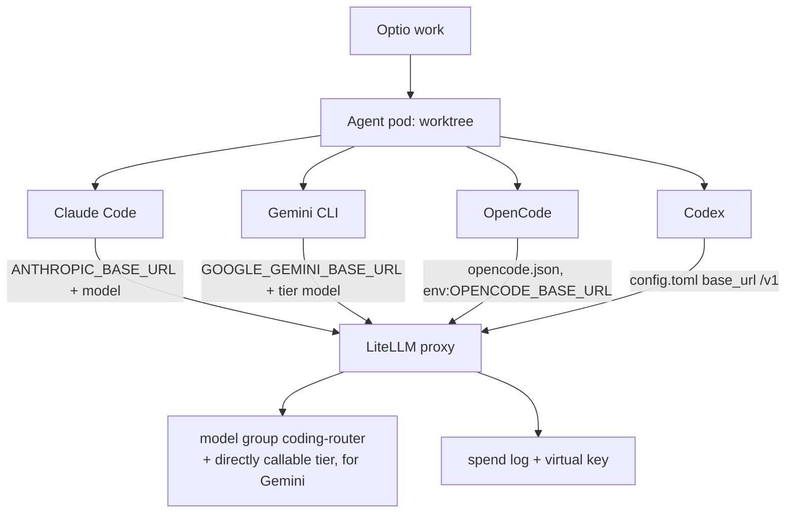

# LiteLLM proxy: one endpoint for every coding agent

## Why

Optio runs coding agents as Tasks: Claude Code, Gemini CLI, OpenCode, and Codex. Without a
central endpoint, each agent is configured against its provider individually:

- Provider keys live in more than one plaintext context — per agent, per API.
- No central cost tracking, no shared routing, no failover.
- Every new agent API means another direct integration.

Pointing all four agents at one **LiteLLM proxy** concentrates the model calls: one virtual
key, one shared model-routing group, one central spend log. No direct provider key sits in
the repo or the pod; a repo clone without the Optio wiring has no working models — the
intended visibility boundary.

## What

**Scope:** exactly the Optio agent types `claude-code`, `gemini`, `opencode`, and `codex`.



The four CLIs read config differently, and that decides the wiring:

| Agent       | reads config from      | wiring                                              | model                         |
| ----------- | ---------------------- | --------------------------------------------------- | ----------------------------- |
| Claude Code | env                    | connection + secret + repo manifest (env drop-in)   | `coding-router`               |
| Gemini CLI  | env                    | connection + secret + repo manifest (env drop-in)   | direct tier (`coding-simple`) |
| OpenCode    | repo config            | `opencode.json` in the repo, values via `{env:...}` | `coding-router`               |
| Codex       | `~/.codex/config.toml` | repo hook `.optio/setup.sh` writes the file         | `coding-router`               |

**Recommendation:** Claude Code and OpenCode run against the `coding-router` model group
(full model routing), Gemini against a directly callable tier model (native `generateContent`
cannot be pre-routed), Codex against the router.

**Required building blocks:**

- **LiteLLM proxy** with a URL, virtual keys, and at least one model group that routes the
  target models; for Gemini additionally a directly callable tier model (no router).
- **Optio connection**: exports the base-URL variables (and any needed flags) into the task
  environment of every repo it is assigned to.
- **Optio secrets**: per agent API, the virtual LiteLLM key.
- **Repo manifest** (or the work's agent options): which model each agent uses.
- For OpenCode and Codex: **one file in the repo itself** (`opencode.json` and
  `.optio/setup.sh`) in every repo where the agent runs.

## How

Hosts below are placeholders: `http://litellm:4000` is the proxy's in-cluster address.
The proxy must be reachable from agent pods (this is a pod-to-proxy call, not an API-side
one, so the API's outbound URL guard does not apply).

### 1. Prepare the LiteLLM proxy (once, outside Optio)

- Run the proxy (here `http://litellm:4000`, OpenAI-compatible under `/v1`).
- Create the model group `coding-router` with the desired tier/failover logic.
- Create a directly callable tier model for Gemini (here `coding-simple`).
- Create one virtual API key (here: secret `optio-litellm` → key `API_KEY`). That single key
  serves all four agents.

### 2. Optio secrets

Each value is the virtual LiteLLM key:

| Secret              | used by          | way                                 |
| ------------------- | ---------------- | ----------------------------------- |
| `ANTHROPIC_API_KEY` | Claude Code      | env in the task environment         |
| `GEMINI_API_KEY`    | Gemini CLI       | env in the task environment         |
| `OPENAI_API_KEY`    | OpenCode + Codex | env in the task env / `config.toml` |

### 3. Optio connection `litellm-env`

A connection of a custom provider with `shellEnv` (`exportShellEnv = true`), assigned to the
repos of the workspace:

```yaml
ANTHROPIC_BASE_URL: http://litellm:4000
GOOGLE_GEMINI_BASE_URL: http://litellm:4000
GEMINI_CLI_TRUST_WORKSPACE: "true"
OPENCODE_BASE_URL: http://litellm:4000/v1
OPENCODE_MODEL: coding-router
OPENAI_BASE_URL: http://litellm:4000
```

The worker spreads a connection's shell env **last**, so these values beat the deployment's
defaults. The base URLs make each CLI talk to the proxy with the virtual key instead of the
real provider endpoint.

### 4. Repo manifest

```yaml
defaultAgentType: claude-code
claudeModel: coding-router
claudeContextWindow: 200k
geminiModel: coding-simple
opencodeModel: litellm/coding-router
opencodeAgent: build
opencodeBaseUrl: null # required — see the OpenCode pitfalls
copilotModel: coding-router # Codex shares Copilot's fields
```

### 5. Claude Code

No extra step — the agent takes the base URL from the connection (`ANTHROPIC_BASE_URL`) and
the key from the secret. The manifest sets `claudeModel: coding-router`.

Pitfalls:

- **`claudeContextWindow` must not be the default `1m`**, or Optio builds
  `--model coding-router[1m]`, which the proxy does not route. Proven value: `200k`.
- **Preflight haiku call**: Claude Code hardcodes `claude-haiku-4-5-20251001` at startup.
  Without a matching model it lands as a 400 in the spend log. Optionally set
  `ANTHROPIC_SMALL_FAST_MODEL = coding-router`.

### 6. Gemini CLI

The base URL (`GOOGLE_GEMINI_BASE_URL`), workspace trust and the key come from the
connection and the secret; the manifest sets `geminiModel: coding-simple`.

Pitfall:

- **No router model**: the Gemini CLI speaks native `generateContent`; the complexity router
  cannot pre-route it (`no pre-routing strategy selected a deployment`). It needs a directly
  callable tier model (`coding-simple`), not `coding-router`.

### 7. OpenCode

**File `opencode.json` in the repo** (in every repo where OpenCode runs):

```json
{
  "provider": {
    "litellm": {
      "npm": "@ai-sdk/openai-compatible",
      "options": {
        "baseURL": "{env:OPENCODE_BASE_URL}",
        "apiKey": "{env:OPENAI_API_KEY}"
      },
      "models": { "{env:OPENCODE_MODEL}": {} }
    }
  },
  "permission": {
    "external_directory": "allow",
    "bash": "allow"
  }
}
```

OpenCode reads **no** `OPENAI_BASE_URL` from the environment — only its config. Values come
in as `{env:...}` references from the connection (`OPENCODE_BASE_URL`, `OPENCODE_MODEL`) and
the secret (`OPENAI_API_KEY`), so nothing is hardcoded in the repo. `{env:...}` is a text
substitution OpenCode applies to the whole config, so it works in JSON keys too — the model
key stays `{env:OPENCODE_MODEL}` (E2E verified; the variable must be set in the agent pod,
otherwise the key becomes empty and the config invalid). `permission` is required, or
OpenCode denies access to `/tmp/*`.

Pitfalls:

- **`OPENCODE_MODEL` must equal the model key without the provider prefix**: Optio starts
  `opencode --model litellm/coding-router` (from `opencodeModel: litellm/coding-router`), and
  the key in `models` expands to `coding-router`. A mismatch → model not found.
- **`opencodeBaseUrl` must be explicitly `null`** — not just omitted. As soon as _any_ base
  URL is configured (`opencodeBaseUrl` in the manifest **or** the secret
  `OPENCODE_DEFAULT_BASE_URL`), the Optio adapter sets only the placeholder key
  `sk-no-key-required` and removes `OPENAI_API_KEY` from the injected secrets → 400
  `Authentication Error Invalid proxy server token`. Config-as-code also compares only the
  fields present in a manifest: an omitted field leaves the old DB value standing. Hence the
  explicit `null`.
- **Do not create the secret `OPENCODE_DEFAULT_BASE_URL`** (the adapter treats it as a base
  URL → placeholder key).
- **`reasoningSummary`**: OpenCode sends the field; the LiteLLM proxy must set
  `additional_drop_params: ["reasoningSummary"]`, or the provider schema check rejects it.

### 8. Codex

**Repo hook `.optio/setup.sh` in the repo** (in every repo where Codex runs) — Codex ignores
environment variables and repo files `.codex/config.toml`:

```bash
#!/usr/bin/env bash
set -euo pipefail
mkdir -p "${HOME}/.codex"
cat > "${HOME}/.codex/config.toml" <<'EOF'
model_provider = "litellm"
model = "coding-router"

[model_providers.litellm]
name = "LiteLLM"
base_url = "http://litellm:4000/v1"
env_key = "OPENAI_API_KEY"
wire_api = "responses"
EOF
```

Optio runs the hook at pod init (`scripts/repo-init.sh`, guarded by
`! -f /workspace/.setup-complete`) and so writes the provider config into the agent home.
The virtual key arrives at launch from the secret `OPENAI_API_KEY`. The manifest sets
`copilotModel: coding-router` (Codex shares Copilot's fields → `codex exec -m coding-router`).

Notes:

- **`wire_api = "responses"` is required** — Codex ≥ 0.151 no longer supports `"chat"`.
- **The hook runs once per pod** (`/workspace/.setup-complete`). After changing it, set the
  pod up anew (an idle pod is cleaned up and re-provisioned).
- **Runs that also inject MCP servers** move `CODEX_HOME` to the run's own home
  (`$OPTIO_CODEX_HOME`); the provider config must then live at
  `$CODEX_HOME/config.toml` instead of `~/.codex/config.toml`.

### 9. Verify

- Start one Task per agent.
- In the **LiteLLM spend log** (GET `/spend/logs`, master key) each CLI's calls must be
  visible: `model_group` = the configured group (exception Gemini: the direct tier model),
  the virtual key, and `user_agent` = `claude-cli/…`, `GeminiCLI-tui/…`, `opencode/…`, or
  `codex_exec/…`.
- For OpenCode additionally check that the real key (not `sk-no-key-required`) arrived.
